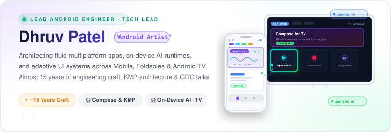
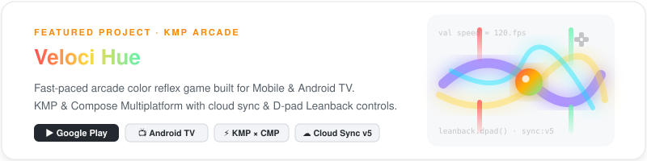
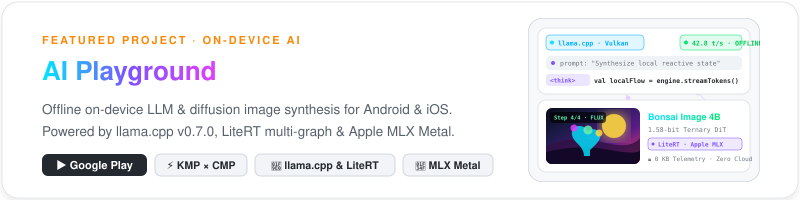
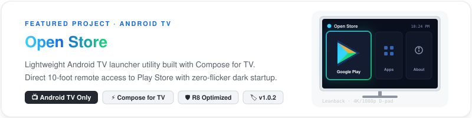

# Dhruv Patel · `@DearDhruv`

  

  
  
  
  

Lead Android Engineer with **almost 15 years** of experience building scalable Android applications, leading teams, and delivering performant, user-centric products across global markets. Specialized in **Kotlin Multiplatform (KMP)**, **Jetpack Compose / Compose for TV**, **on-device AI (LLM & diffusion image synthesis runtimes)**, and **adaptive layouts** across phones, foldables, tablets, and TV screens — with strong expertise in **hardware integrations**, **multimedia pipelines**, and **technical speaking** at developer conferences.

  

## 🧰 Tech Stack

**Languages**  
  

**Android & UI**  
    

**Multiplatform**  
  

**On-Device AI & Multimedia**  
     

**Data, Cloud & APIs**  
   

**Architecture & Build**  
    
Clean Architecture · MVI · MVVM · Modularization

  

## 🚀 Featured Projects

  

  

  

  

## 🎤 Speaking · GDG DevFests & Workshops

| Year | Talk | Where |
|---|---|---|
| **Dec 2025** | Jetpack Compose - Game-changing features (Navigation 3, Adaptive, Performance, Accessibility) | Surat 🇮🇳 |
| **Nov 2025** | Android 17 Mandates - Adaptive Layouts across all form factors | Ahmedabad 🇮🇳 |
| **Jun 2022** | What's New in Android 13 | Gandhinagar 🇮🇳 |
| **Sep 2019** | UI & UX with Ease for Mobile | Surat & Rajkot 🇮🇳 |
| **Sep 2018** | Android Jetpack - Slices | Ahmedabad 🇮🇳 |
| **Feb 2018** | DialogFlow - Chatbot Creation Workshop | Anand & Rajkot 🇮🇳 |

  

## 📊 GitHub at a Glance

  

  
  
  

  

## 🤝 Let's Build Something

- 💼 **Freelance / Contract** - Open for interesting Android, KMP, or CMP projects. Reach out via <a href="mailto:dhruv.time@gmail.com" target="_blank" rel="noopener noreferrer">email</a>.
- 💬 **Ask me anything** - Android architecture, Kotlin, Compose, KMP/CMP, hardware integration, multimedia, or tech leadership - find me on <a href="https://x.com/DearDhruv" target="_blank" rel="noopener noreferrer">X</a> or <a href="https://linkedin.com/in/DearDhruv" target="_blank" rel="noopener noreferrer">LinkedIn</a>.
- 🎤 **Invite me to speak** - Happy to talk at meetups and DevFests on Compose, adaptive layouts, and modern Android.

  

## 🌌 Off the Clock

  🪐 <b>Astronomy</b> &nbsp;·&nbsp; 🎌 <b>Anime</b> &nbsp;·&nbsp; ♟️ <b>Chess</b>

  

  <i>"Android Artist"</i>

